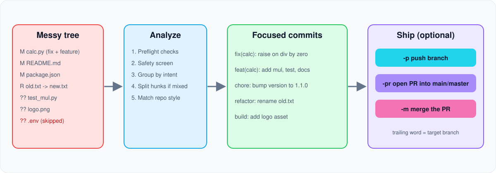
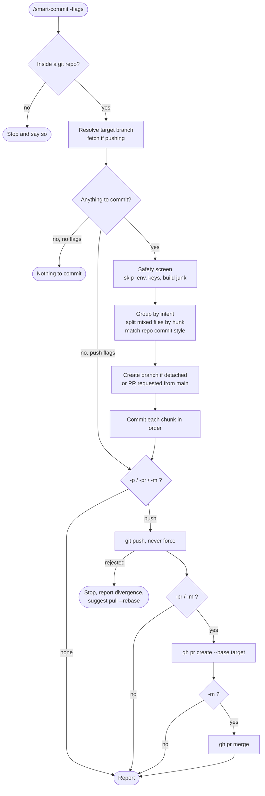

<div align="center">


# smart commit

**Turn a messy working tree into a clean, reviewable git history. One phrase, zero ceremony.**

[](LICENSE)
[](#install)
[](#option-1--claude-code-plugin-marketplace)
[](docs/how-it-works.md#test-matrix)
[](#requirements)

</div>

---

## What it does

You type **`/smart-commit`**. Claude:

1. **Reads** every uncommitted change (staged, unstaged, untracked, renames, deletes, binaries).
2. **Groups** them by *intent*, not by file. A bug fix and a new feature in the same file become two commits.
3. **Commits** each group with a proper message that matches your repo's existing style.
4. **Optionally ships it:** push, open a PR, even merge it.

No more `git add -A && git commit -m "stuff"`.



## Usage

```text
/smart-commit [-p] [-pr] [-m] [target-branch]
```

| Command | What happens |
|---|---|
| `/smart-commit` | Group + commit. Nothing leaves your machine. |
| `/smart-commit -p` | ...then push the branch (sets upstream if needed). |
| `/smart-commit -pr` | ...then open a PR into `main` / `master` (auto-detected). |
| `/smart-commit -pr develop` | ...PR into `develop` instead. The trailing word is the target branch. |
| `/smart-commit -m` | ...push, open the PR, and **merge** it. |
| `/smart-commit -m release` | ...merge into `release`. |

Flags stack: `-m` implies `-pr`, `-pr` implies `-p`.

## Before and after

<table>
<tr><th>Without</th><th>With <code>/smart-commit</code></th></tr>
<tr><td>

```text
a1b2c3d  wip
e4f5g6h  fixes
i7j8k9l  more changes
```

</td><td>

```text
f3a91c2  fix(calc): raise ValueError on division by zero
7be0d44  feat(calc): add mul function
1c88a05  chore: bump version to 1.1.0
```

</td></tr>
</table>

## How it thinks



## Built-in guardrails

| Risk | What the skill does |
|---|---|
| Secrets (`.env`, `*.pem`, keys in the diff) | Skipped and warned. Never committed. |
| Build junk (`node_modules`, `dist`, `*.log`) | Skipped; suggests a `.gitignore`. |
| PR from `main` into `main` | Creates a `feat/...` or `fix/...` branch first. |
| Detached HEAD | Creates a branch, pushes that, leaves `main` alone. |
| Push rejected (remote ahead) | Stops, reports, suggests `git pull --rebase`. Never pulls or rebases for you. |
| Force push / `--no-verify` / `--admin` merge | **Never.** |
| Blocked merge (checks, reviews) | Reports why and stops. No polling loops. |
| `gh` missing or remote is not GitHub | Commits and push still stand; the PR step reports what is needed. |

## Install

### Option 1 - Claude Code plugin marketplace

```text
/plugin marketplace add KarmitP98/smart-commit-skill
/plugin install smart-commit@smart-commit-marketplace
```

### Option 2 - Drop in the skill folder

```powershell
# Windows (PowerShell)
git clone https://github.com/KarmitP98/smart-commit-skill.git
Copy-Item -Recurse smart-commit-skill\skills\smart-commit $HOME\.claude\skills\
```

```bash
# macOS / Linux
git clone https://github.com/KarmitP98/smart-commit-skill.git
cp -r smart-commit-skill/skills/smart-commit ~/.claude/skills/
```

### Option 3 - Claude app

Download `smart-commit.skill` from the [latest release](../../releases/latest) and click **Save skill**.

## Make Claude use it automatically

Installing the skill makes `/smart-commit` available. To have Claude reach for it whenever you ask for a commit in plain language, add a short instruction to your `CLAUDE.md`. Claude Code reads this file at the start of every session.

| Scope | File | Applies to |
|---|---|---|
| All your projects | `~/.claude/CLAUDE.md` (Windows: `%USERPROFILE%\.claude\CLAUDE.md`) | Every repository on your machine |
| One project | `CLAUDE.md` in the repository root | That repository, and anyone who clones it |

Paste the following into the file you chose:

```markdown
## Git workflow

Always use the `/smart-commit` skill for any git commit, push or pull request.
Never run a bare `git commit` for these requests.

| When I say...                                              | Run...                                  |
|------------------------------------------------------------|-----------------------------------------|
| "commit this", "commit my changes"                         | `/smart-commit`                         |
| "commit and push", "push this"                             | `/smart-commit -p`                      |
| "create a PR", "generate a PR", "open a PR"                | `/smart-commit -pr`                     |
| "create a PR to <branch>", "generate a PR into <branch>"   | `/smart-commit -pr <branch>`            |
| "commit and merge", "create a PR and merge it"             | `/smart-commit -m`                      |
| "merge it into <branch>"                                   | `/smart-commit -m <branch>`             |

Only use `-m` when I explicitly ask to merge. If I do not name a target
branch, let the skill default to `main` or `master`.
```

How the mapping works:

- **`-p`, `-pr` and `-m` build on each other.** `-m` implies `-pr`, and `-pr` implies `-p`, so you only ever need the highest flag for what you asked.
- **The branch name always comes last.** `/smart-commit -pr develop` opens the PR into `develop`.
- **Merging stays opt-in.** The last line of the snippet keeps `-m` reserved for requests that explicitly mention merging, because a merge is the one step that is hard to undo.

Tip: adjust the trigger phrases to the way you actually talk. The table is a plain instruction to Claude, so any wording you add is honored.

## Requirements

- `git`
- [`gh`](https://cli.github.com/) (GitHub CLI), authenticated. Only needed for `-pr` and `-m`.

## Quick numbers

| | |
|---|---|
| Flags | 3 (`-p`, `-pr`, `-m`) + optional target branch |
| Workflow steps | 8 (preflight to merge) |
| Test scenarios | 7 end-to-end, all passing |
| Dependencies | `git`, optionally `gh` |
| Skill size | one `SKILL.md`, no scripts |

See [docs/how-it-works.md](docs/how-it-works.md) for the grouping rules, hunk-splitting mechanics and the full test matrix.

## Honest limits

- Grouping is done by Claude's judgment of intent. It is usually right, but review the log (`git log --stat`) before you push anything important.
- PR and merge were validated against a stubbed `gh`, not live GitHub. Try `-pr` on a throwaway repo first.
- `-m` merges with a merge commit and falls back to squash/rebase only if the repo requires it.

## License

[MIT](LICENSE) &copy; 2026 KarmitP98
